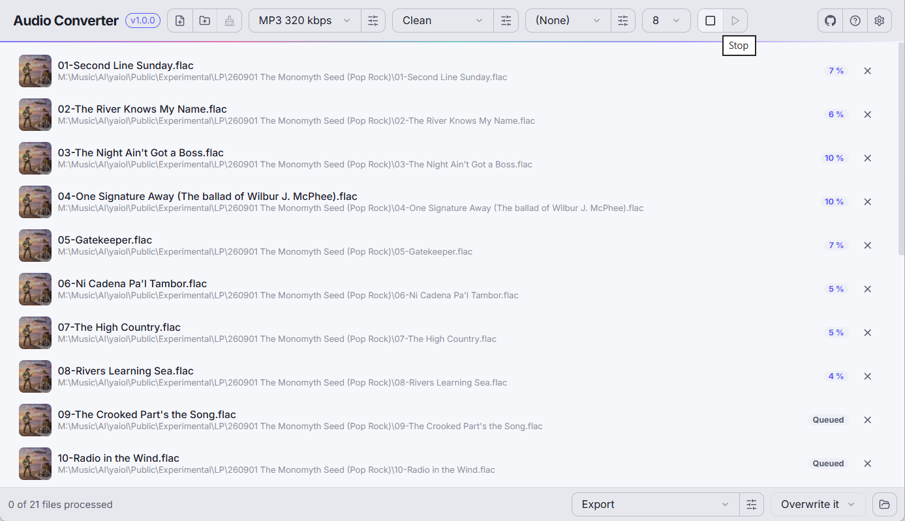

<p align="center">
  
</p>

<h1 align="center">Audio Converter</h1>

<div align="center">
  <strong>Convert audio between 18 formats without losing the tags.</strong><br>
  Drop files in, pick a preset, convert - with the tags, the cover and the language still there.
</div>

<br>

<!-- readme:nav -->

<div align="center">
  <a href="../../releases/latest"></a>
  <a href="../../releases"></a>
</div>

<h3 align="center">
  <a href="https://apps.yaiol.com/p/audio-converter/">Website</a>
  <span>&nbsp;·&nbsp;</span>
  <a href="#install">Install</a>
  <span>&nbsp;·&nbsp;</span>
  <a href="#what-it-is">Features</a>
  <span>&nbsp;·&nbsp;</span>
  <a href="#documentation">Documentation</a>
  <span>&nbsp;·&nbsp;</span>
  <a href="#build-from-source">Development</a>
</h3>

<div align="center">
  <sub><a href="https://apps.yaiol.com/p/audio-converter/help/"><b>Help in 28 languages</b></a></sub>
</div>

<!-- /readme:nav -->

---

<p align="center">
  
</p>

---

## Install

<div align="center">

<table align="center">
<tr>
<th align="center">Windows</th>
<th align="center">macOS</th>
<th align="center">Linux</th>
</tr>
<tr>
<td align="center"><a href="../../releases/latest"></a></td>
<td align="center"><a href="../../releases/latest"></a></td>
<td align="center"><a href="../../releases/latest"></a></td>
</tr>
<tr>
<td align="center">x64 installer</td>
<td align="center">Apple Silicon</td>
<td align="center">deb package or AppImage</td>
</tr>
</table>

</div>

> **Windows note:** SmartScreen may warn on first launch because the app is not code-signed. Click "More info", then "Run anyway".
>
> Windows is the platform the app is developed and tested on; the macOS and Linux packages are built from the same source on release and have had less use.

---

## What it is

Audio Converter turns audio files into another format, in the spirit of fre:ac and MediaHuman: you drop files or folders on the window, pick what the output should be, and convert. Several files run at once, each with its own progress, and a run can be cancelled per file.

What sets it apart is that three choices are made separately, each from its own drop-down in the header: the **preset** (what the output is), the **tags** setting (which tags and cover are kept) and the **effects** setting (what is done to the sound). One preset can be used with a setting that strips the comments, with another that normalises the volume, or with neither.

---

## Features

- **Eighteen output formats** - MP3, AAC, ALAC, FLAC, WAV, AIFF, Ogg Vorbis, Opus, WMA, WavPack, TTA, MP2, AC-3, Wave64, AU, FLAC in Ogg, iPhone ringtone (M4R) and raw AAC. Anything ffmpeg can decode goes in.
- **Tags that survive the trip** - a field keeps its meaning from format to format under the name a tag editor shows (album artist, sort names, composer, BPM, lyrics, ISRC, custom fields), with repeated fields, track and disc totals and the whole date kept, and the cover picture carried to every format that can hold one.
- **Tag cleaning as a setting** - keep everything except a list, or delete everything except a list, with wildcards; the cover has its own switch.
- **An effects chain** - trim silence, keep a range, limit the length, channels, repair, low cut, noise reduction, de-esser, ten-band equaliser, bass and treble, dynamics, tempo, volume (loudness, peak, ReplayGain or fixed gain), fades, silence at the end, and ReplayGain tags with album gain.
- **Presets with the encoder's own switches** - one quality setting per format, plus MP3, Vorbis, Opus, FLAC and AAC options, optional dither at 16 bit, and an (Original) choice that keeps each file's own format.
- **Where the files go** - a folder and a file-name pattern (`{artist}/{album}/{track} - {title}`), with the source's folder structure kept, and skip, overwrite or keep-both when a file exists.
- **A command line** - `yac` ships beside the app and uses the same saved presets, tag settings, effects and destinations: `yac -p "MP3 320 kbps" -d Export Music/`. `yac --list` shows what can be named.
- **Your language** - the interface is available in 52 languages.

---

## Documentation

| | |
|---|---|
| **User manual** | [Read it online](https://apps.yaiol.com/p/audio-converter/help/) |
| **What's new** | [Release notes](https://apps.yaiol.com/p/audio-converter/help/releases/) |
| **Tag name reference** | [Technical reference](https://apps.yaiol.com/p/audio-converter/help/technical-reference/) |
| **Product page** | [apps.yaiol.com](https://apps.yaiol.com/p/audio-converter/) |

---

## Build from source

Requires the Rust toolchain (stable) and, for the installer, the Dioxus CLI (`cargo install dioxus-cli`). The app drives **ffmpeg**, which is not committed: `scripts/fetch-ffmpeg.sh <windows|linux|macos>` puts an LGPL build in `app/resources/`, and during development the one on your `PATH` is used.

```bash
cargo run -p audio-converter                                                    # run in development
cargo test                                                      # engine and app tests (the conversion tests need ffmpeg)
cd app && dx bundle --desktop --release --package-types nsis    # Windows installer → release/
```

---

## Architecture

A Cargo workspace of three crates: the **engine** (everything that is not the window - formats, presets, tags, effects, the job queue and the ffmpeg driver, with no UI dependency) the **app** (the Dioxus desktop shell, which polls the engine every 200 ms; the engine never calls back into the window) and the **cli** (`yac`: argument parsing and a printed summary over the same engine and the same saved settings).

| Layer | Technology |
|-------|-----------|
| UI | Dioxus 0.7 on the system WebView |
| Audio engine | ffmpeg, bundled as a separate LGPL executable |
| Tag writing | lofty, plus a header rewriter for WMA |
| Interface languages | flat JSON bundles embedded at build time |
| Packaging | `dx bundle` (NSIS, deb, AppImage, dmg) |

<details>
<summary><b>How tags are carried</b></summary>

ffmpeg copies most tags, but it renames some, drops others and flattens repeated fields. After every conversion the engine reads the source again and writes back what ffmpeg lost, through each format's own tag type. One table, `engine/src/mapping.rs`, says what each field is called in every standard (ID3v2.3, ID3v2.4, MP4 atoms, WMA attributes, Vorbis and APE names, WAV INFO ids). A test converts every one of the eighteen formats into every other and checks that each field is still there.

</details>

<details>
<summary><b>How effects are measured</b></summary>

Effects run in a fixed order as one ffmpeg audio-filter chain. At most two measuring passes come first: a scan for silence, and loudness meters taken through the effects that come before the volume, so a normalisation reaches its target without clipping. Album gain measures all files of one album as one programme.

</details>

---

## License

Released under the [MIT License](LICENSE).

The installer bundles [ffmpeg](https://ffmpeg.org) as a separate executable, built under the LGPL; it is not part of this repository and keeps its own licence.

<div align="center">
  <sub>Audio Converter is part of <a href="https://apps.yaiol.com">yaiol Applications</a>.</sub>
</div>
